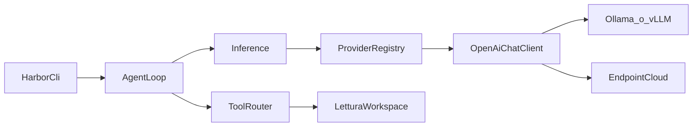

# Prossimi passi, sul modello di ClawLite

ClawLite è un agente locale sempre acceso: canali (Telegram, Discord, …), memoria ibrida, tool, failover tra provider e una dashboard. Sotto, i modelli passano da LiteLLM: un formato messaggi, tanti endpoint. Harbor non deve clonare quella superficie. Il pezzo da copiare è il confine: il loop non conosce il vendor, conosce una richiesta di completamento.

Oggi Harbor ha solo id di sessione/workspace, una CLI `info` / `run` (run esce subito) e una sandbox Linux ancora non affidabile. Non c’è un messaggio, un tool, né una chiamata HTTP.

## Cosa fare, in ordine

- **Inferenza unica.** Un completamento non-streaming, un provider di default, test senza rete. È il primo codice da scrivere.
- **Loop con tool in sola lettura.** `read_file` e `list_dir` confinati alla root del workspace (path canonico, niente fuga con `..`). Tetto di turni e di token. `exec`, rete, browser e scrittura file restano spenti finché la sandbox Linux non è davvero enforced: ClawLite li ha, Harbor no, e il backend Landlock è ancora quello rinviato.
- **Stream verso il terminale.** Lo stesso client, a chunk. Il loop resta sul completamento completo finché i tool non sono stabili.
- **Sessione su SQLite.** Transcript appeso a `SessionId`. Memoria BM25/vettoriale, cron, heartbeat e canali arrivano solo dopo che una sessione si riapre e il loop si ferma da solo.

Fuori da questi passi: dashboard, skill marketplace, OAuth Gemini/Qwen, self-evolution su git, Telegram/Discord.

## Modelli, provider, inferenza

Un provider è configurazione, non una crate per vendor. Due protocolli bastano nel tempo; il primo è uno solo.

- **Protocollo.** `openai-chat`: Chat Completions. Copre OpenAI, Groq, DeepSeek, OpenRouter, Mistral, Ollama e vLLM (`/v1`). Anthropic Messages è un secondo adattatore, più avanti, perché i tool non sono lo stesso JSON.
- **Identità modello.** `provider/model` (es. `ollama/llama3.2`). Il registry risolve prefisso, base URL e nome della variabile d’ambiente della chiave. La chiave si legge al momento della chiamata e non si scrive nel file di config né nei log.
- **Catalogo.** `harbor.toml`: id, `base_url`, `api_key_env` opzionale, modello di default, context window. Preset iniziali: Ollama su `127.0.0.1:11434` e un endpoint cloud. `fallback = ["ollama", "openai"]` prova il successivo solo su timeout, 429 e 5xx. 401 e 400 si fermano.
- **Contratto.** Crate `harbor-infer`, trait piccolo: `complete(request) -> Completion`. `Completion` porta testo, `tool_calls` (vuoti all’inizio) e usage. Il loop e la CLI dipendono da questo, non da reqwest. Un `ScriptedInference` copre i test; un test HTTP usa un server locale, non un provider vero.
- **Dipendenze.** `tokio` e `reqwest` con rustls solo nel binario e in `harbor-infer`. I tipi messaggio (`role`, contenuto testuale) stanno in [`crates/harbor-core`](crates/harbor-core/src/lib.rs), accanto agli id già casuali.

`harbor run "testo"` smette di uscire con “not implemented”: carica la config, chiama il provider di default, stampa la risposta. Senza config o senza chiave richiesta, esce con errore e non chiama la rete.

## Primo slice, quando si implementa

- Aggiungere `harbor-infer` e i tipi messaggio in `harbor-core`.
- Parser di `harbor.toml` più risoluzione env della chiave.
- Client Chat Completions e wrapper di fallback.
- `harbor run` collegato a quel client.
- Test sul client scriptato e su una risposta HTTP finta. Nessun cambiamento in `harbor-sandbox-linux`.
